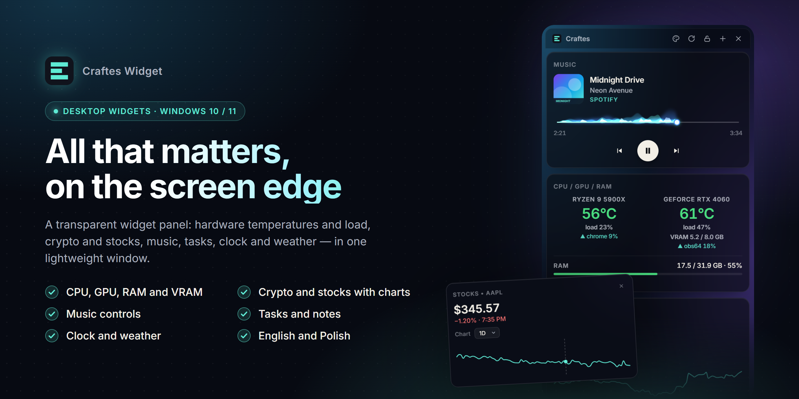
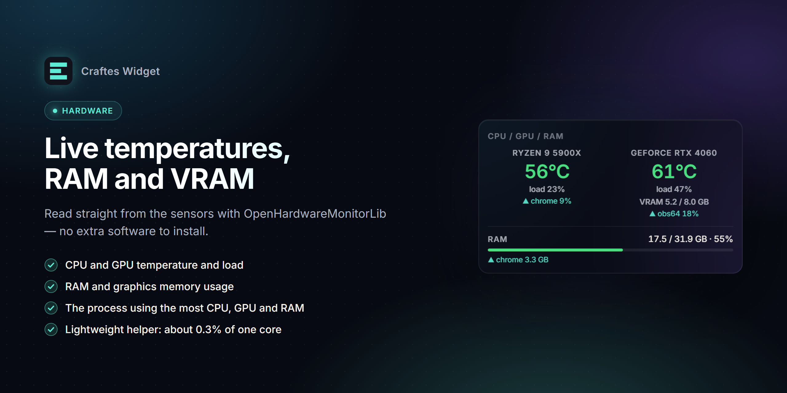
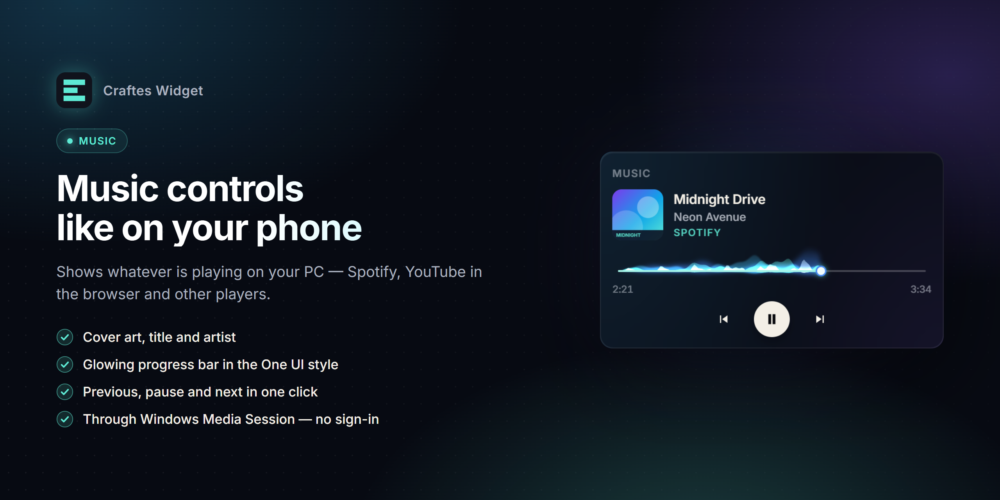
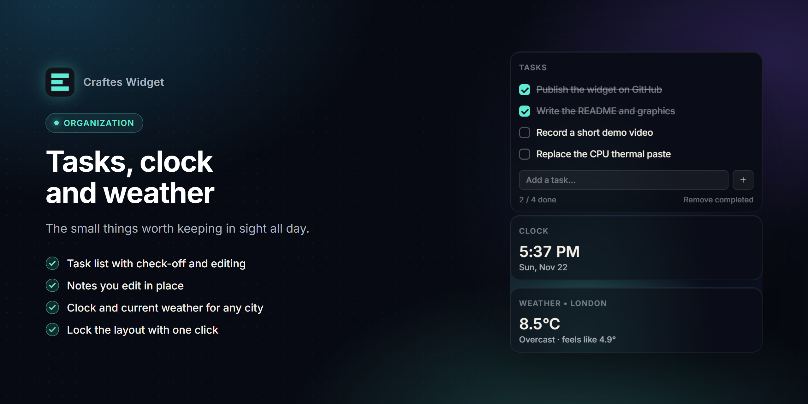
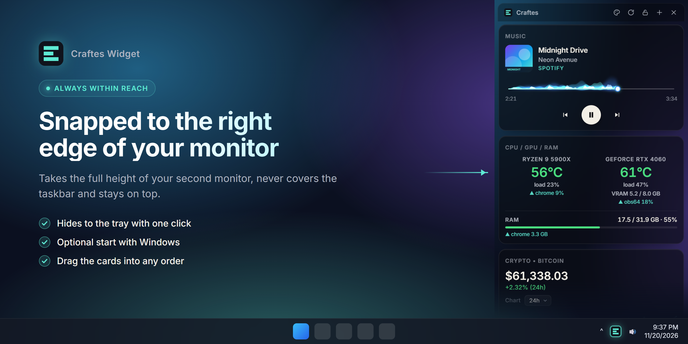

# Craftes Widget

**English** · [Polski](README.pl.md)



A transparent widget panel for the Windows desktop: hardware temperatures and load, RAM and VRAM, crypto and stocks, music controls, tasks, clock and weather. The interface is available in English and Polish.

| | |
|---|---|
|  |  |
|  |  |



## Download

1. Download `Craftes-Widget-<version>-win-x64.zip` from **Releases**.
2. Unzip it into any folder, for example `C:\Apps\Craftes Widget`.
3. Run `Craftes Widget.exe`.

The window settings and the sensor driver stay in that folder. To remove the widget, delete the folder.
Requires Windows 10 or 11 x64. The files are not digitally signed, so Windows SmartScreen may show a warning on the first run: choose "More info" → "Run anyway".

## Run from source

```bash
npm install
ohm\build.cmd
npm start
```

`npm run dist` builds the release ZIP (output in `dist/`).

`start.vbs` starts the widget without a console window, and `start-admin.vbs` does the same as administrator.
Only one copy of the widget runs at a time: starting it again shows the window that is already open.

## Window and tray

* The window is snapped to the right edge of the second monitor. It takes the full height of the work area (without the taskbar) and is 380 px wide. It snaps again after a monitor or resolution change.
* `×` hides the widget to the tray. Clicking the tray icon shows or hides it.
* Tray menu (right click):
  * show / hide,
  * **Snap to the right edge**; when it is off, you can move and resize the window,
  * **Always on top**,
  * **Start with Windows**,
  * **Refresh all**,
  * **Quit**.
* Window settings and the language are saved in `config.json` (next to `Craftes Widget.exe`, or in the project folder when run from source).
* **Appearance and language:** the palette icon in the bar opens a panel with:
  * 10 preset theme colors or any custom color,
  * a card transparency slider,
  * the language switch (**English** / **Polski**); the window reloads in the new language.

  Every shade (buttons, selections, charts, the music bar glow and the app mark) is derived from that one color. For very dark colors (e.g. Purple `#6a1a87`), text, icons and lines get a lighter variant of the same hue so they stay readable. Status colors stay fixed: green, yellow and red for temperatures and RAM, green and red for price changes. **Default** restores teal and 38% transparency.

## Widgets

| Widget | Data source |
|---|---|
| Crypto | Binance, with CoinGecko as a fallback |
| Stocks | Yahoo Finance, no key. Symbols: `AAPL`, `MSFT`, other exchanges with a suffix (e.g. `SAP.DE`, `PKN.WA`) |
| CPU / GPU / RAM | `ohmhelper.exe`: temperatures, load, VRAM, RAM and the process using the most CPU, GPU and RAM |
| Music | `mediahelper.exe` (Windows Media Session): Spotify, YouTube in the browser and others. Runs only while the widget is on the panel |
| Tasks | checklist; double-click a task to edit it |
| Weather / Clock / Note | Open-Meteo / local |

The libraries (Chart.js, Sortable) and the Inter font are in `vendor/`, so the interface downloads nothing from the internet.

## Temperatures (OpenHardwareMonitorLib + WinRing0)

Everything lives in the `ohm/` folder. Nothing is downloaded and nothing is written to AppData or %TEMP%.

| File | Role |
|---|---|
| `ohm/src/Program.cs`, `ProcStats.cs` | sensor helper source (RAM and processes via `NtQuerySystemInformation`, per-process GPU via the "GPU Engine" counter) |
| `ohm/src/MediaHelper.cs` | music helper source |
| `ohm/build.cmd` | builds both helpers with the `csc.exe` that ships with Windows (.NET Framework 4.x) and the system `.winmd` files; no dotnet SDK, Windows SDK, NuGet or internet needed |
| `ohm/ohmhelper/ohmhelper.exe` | helper that runs all the time and reports a JSON reading every 2 s |
| `ohm/ohmhelper/OpenHardwareMonitorLib.dll` (+ dependencies) | the library; the WinRing0x64 driver is embedded in it |
| `ohm/ohmhelper/ohmhelper.sys` | the WinRing0 driver unpacked by the library; it exists only while the helper runs as admin, and the library removes it on exit |

* **Without admin:** GPU temperature and load (NvAPI/ADL) and CPU load.
* **CPU temperature** needs the WinRing0 driver, so it requires administrator rights. You have two options:
  * click **"Read CPU (admin)"** in the widget: the helper starts through UAC, sends readings over a named pipe and closes together with the widget (the "always at startup" option does this automatically),
  * or start the whole widget with `start-admin.vbs`.

Diagnostics (full sensor list):

```bat
ohm\ohmhelper\ohmhelper.exe --report
```

After changing files in `ohm/src`, run `ohm\build.cmd`.

### Why nothing goes to AppData

* `Computer.Open(true)` is the "portable" mode: WinRing0 goes to `ohm/ohmhelper/ohmhelper.sys`. With `Open(false)` the library always uses `%TEMP%\tmpXXXX.sys`.
* The helper's `TMP` and `TEMP` point to `ohm/ohmhelper/tmp`, which is cleaned at startup and on exit (unless it is a junction or a link).
* InpOut (`inpoutx64`) is blocked. The library only uses it for the Ryzen power table, but it always unpacks it to `%TEMP%` and installs a driver in `System32\drivers`.

If the driver fails to load, the widget writes the reason to `ohm/ohmhelper/driver.log`.

### Security

* **The admin helper writes no data files.** It sends readings over a named pipe with a random name created by the widget. It connects at the *Identification* level, so the pipe server cannot use its rights. It exits when the widget closes the pipe.
* **The admin process handles files in the app folder carefully**, because that folder is writable by a normal account:
  * before unpacking the driver it removes the name `ohmhelper.sys`, in case it is a planted link,
  * the write test creates a new, random file,
  * it does not clean the `tmp` folder if it is a junction or a link.
* **The WinRing0 device is available to administrators only.** A normal program cannot use it, even while the helper is running.
* **The widget window shows no foreign content:**
  * the CSP allows only scripts, styles and fonts from the app folder,
  * navigation, new windows, `webview` and permission requests (camera, microphone, location) are blocked,
  * text from the internet (song titles, company and process names) is inserted as plain text.
* **Network:** HTTPS only, to Binance, CoinGecko, Yahoo Finance and Open-Meteo. Only price symbols and the city name are sent. Nothing listens on a port, and the helpers do not connect to the network.
* **InpOut is blocked.** Older versions of the widget installed the `inpoutx64` driver (open to every program), so if you have it on your system, consider removing it.

> Note: Malwarebytes ("Blocking vulnerable driver load"), Microsoft Defender (`HackTool:Win32/Winring0`)
> and the Windows 11 "Vulnerable Driver Blocklist" may block WinRing0. In that case the CPU reading will not work even as admin,
> unless you add the `ohm/ohmhelper` folder to the exclusions.
