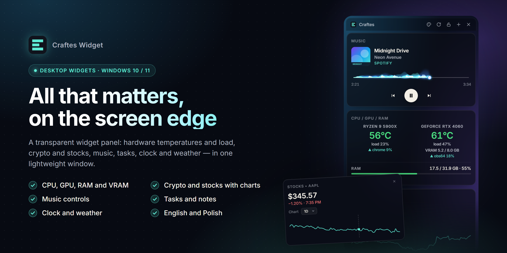
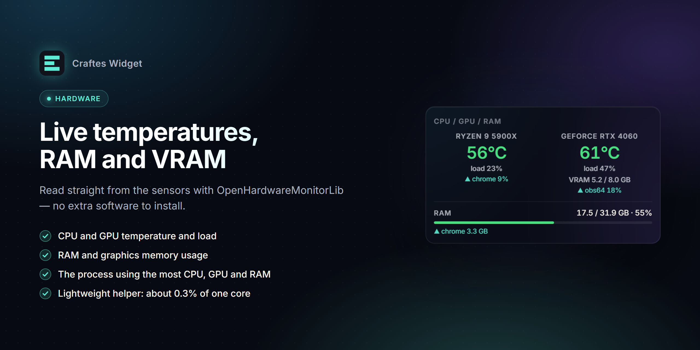
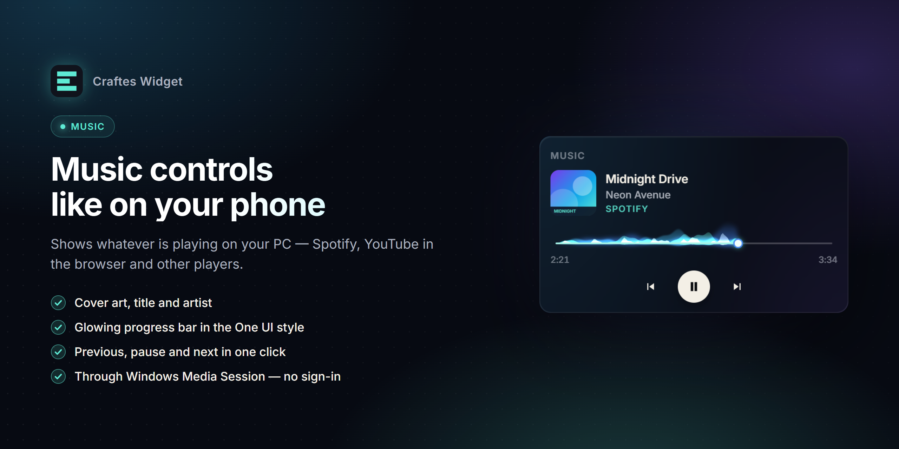
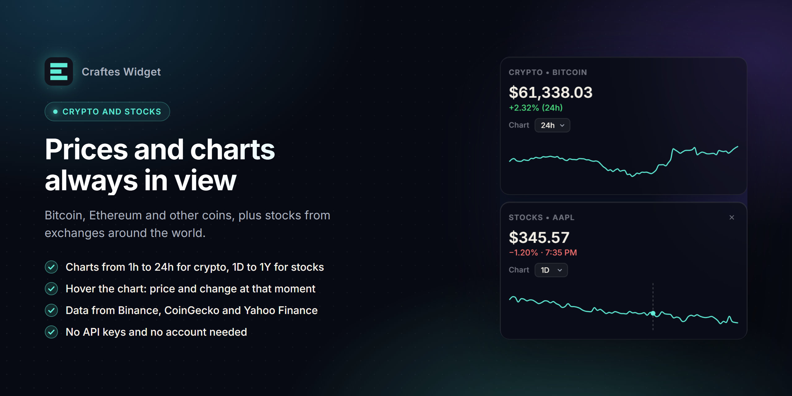
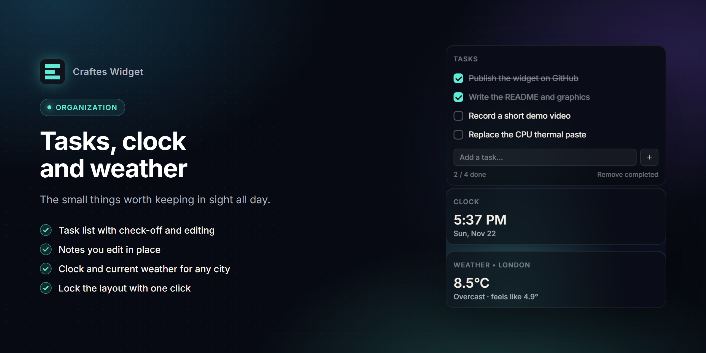
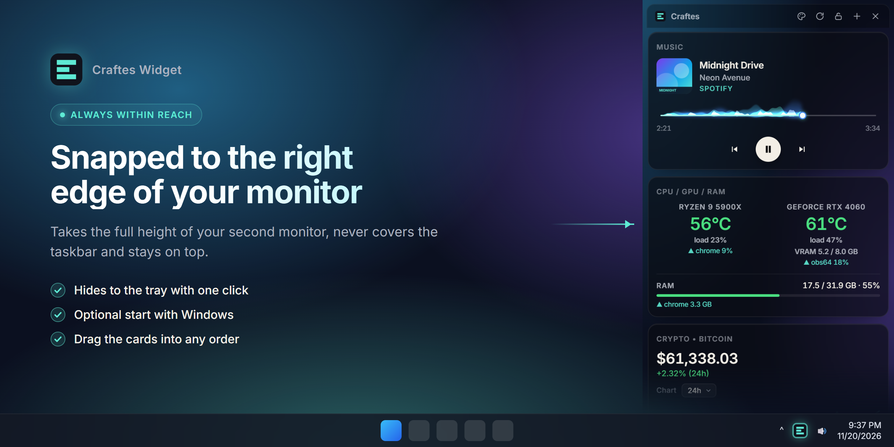

# Craftes Widget v0.25

[English](README.md) · **Polski**



Przezroczysty panel widgetów na pulpit Windows: temperatury i obciążenie podzespołów, RAM i VRAM, krypto i akcje, sterowanie muzyką, zadania, zegar i pogoda. Interfejs jest dostępny po angielsku i po polsku.

| | |
|---|---|
|  |  |
|  |  |



## Pobranie

1. Z zakładki **Releases** pobierz `Craftes-Widget-<wersja>-win-x64.zip`.
2. Rozpakuj go w dowolnym folderze, np. `C:\Programy\Craftes Widget`.
3. Uruchom `Craftes Widget.exe`.

Ustawienia okna i sterownik czujników zostają w tym folderze. Żeby usunąć widget, wystarczy skasować folder.
Wymagany jest Windows 10 lub 11 x64. Pliki nie są podpisane cyfrowo, więc przy pierwszym uruchomieniu Windows SmartScreen może pokazać ostrzeżenie: wybierz „Więcej informacji” → „Uruchom mimo to”.

## Uruchomienie ze źródeł

```bash
npm install
ohm\build.cmd
npm start
```

Paczkę ZIP do wydania buduje `npm run dist` (wynik w `dist/`).

`start.vbs` uruchamia widget bez okna konsoli, a `start-admin.vbs` robi to samo jako administrator.
Widget działa w jednej kopii: ponowne uruchomienie pokazuje już otwarte okno.

## Okno i zasobnik

* Okno jest przyklejone do prawej krawędzi drugiego monitora. Zajmuje całą wysokość obszaru roboczego (bez paska zadań) i ma 380 px szerokości. Po zmianie monitorów lub rozdzielczości przykleja się ponownie.
* `×` chowa widget do zasobnika. Kliknięcie ikony w zasobniku pokazuje go albo chowa.
* Menu zasobnika (prawy przycisk):
  * pokaż / schowaj,
  * **Przyklej do prawej krawędzi**; po wyłączeniu okno można przesuwać i zmieniać jego rozmiar,
  * **Zawsze na wierzchu**,
  * **Uruchamiaj z Windows**,
  * **Odśwież wszystko**,
  * **Zamknij**.
* Ustawienia okna i język są zapisywane w `config.json` (obok `Craftes Widget.exe`, a przy uruchomieniu ze źródeł w folderze projektu).
* **Wygląd i język:** ikona palety w pasku otwiera panel z wyborem jednego z 10 gotowych kolorów albo dowolnego własnego, suwakiem przezroczystości kart i przełącznikiem języka (**English** / **Polski**; okno przeładowuje się w nowym języku). Domyślnie interfejs jest po angielsku. Z tego jednego koloru liczone są wszystkie odcienie: przyciski, zaznaczenia, wykresy, poświata paska muzyki i znak aplikacji. Przy bardzo ciemnych kolorach (np. Purpura `#6a1a87`) tekst, ikony i linie dostają rozjaśniony wariant tego samego odcienia, żeby były czytelne. Kolory znaczeniowe zostają stałe: zielony, żółty i czerwony dla temperatur i RAM oraz zielony i czerwony dla zmian kursów. Przycisk **Domyślne** przywraca turkus i przezroczystość 38%.

## Widgety

| Widget | Źródło danych |
|---|---|
| Krypto | Binance, a gdy nie działa CoinGecko |
| Akcje | Yahoo Finance, bez klucza. Symbole: `AAPL`, `MSFT`, GPW z końcówką `.WA` (np. `PKN.WA`) |
| CPU / GPU / RAM | `ohmhelper.exe`: temperatury, obciążenie, VRAM, RAM i proces, który najbardziej obciąża CPU, GPU i RAM |
| Muzyka | `mediahelper.exe` (Windows Media Session): Spotify, YouTube w przeglądarce i inne. Działa tylko wtedy, gdy widget jest na pulpicie |
| Zadania | lista z odhaczaniem. Podwójne kliknięcie edytuje zadanie |
| Pogoda / Zegar / Notatka | Open-Meteo / lokalnie |

Biblioteki (Chart.js, Sortable) i font Inter leżą w `vendor/`, więc interfejs nie pobiera niczego z internetu.

## Temperatury (OpenHardwareMonitorLib + WinRing0)

Wszystko leży w folderze `ohm/`. Nic nie jest pobierane ani nic nie trafia do AppData ani %TEMP%.

| Plik | Rola |
|---|---|
| `ohm/src/Program.cs`, `ProcStats.cs` | źródło helpera sensorów (RAM i procesy przez `NtQuerySystemInformation`, GPU per proces przez licznik „GPU Engine”) |
| `ohm/src/MediaHelper.cs` | źródło helpera muzyki |
| `ohm/build.cmd` | kompilacja obu helperów przez `csc.exe` z Windows (.NET Framework 4.x) i systemowe pliki `.winmd`, bez dotnet SDK, Windows SDK, NuGet i internetu |
| `ohm/ohmhelper/ohmhelper.exe` | helper, który działa cały czas i co 2 s podaje odczyt w JSON |
| `ohm/ohmhelper/OpenHardwareMonitorLib.dll` (+ zależności) | biblioteka; sterownik WinRing0x64 jest w niej osadzony |
| `ohm/ohmhelper/ohmhelper.sys` | sterownik WinRing0 wypakowany przez bibliotekę; jest tylko wtedy, gdy helper działa jako admin, a przy zamknięciu biblioteka go usuwa |

* **Bez admina:** temperatura i obciążenie GPU (NvAPI/ADL) oraz obciążenie CPU.
* **Temperatura CPU** wymaga sterownika WinRing0, więc potrzebne są uprawnienia administratora. Masz dwie opcje:
  * w widgecie kliknąć **„Odczyt CPU (admin)”**: helper startuje przez UAC, przesyła odczyty nazwanym potokiem i sam się zamyka razem z widgetem (opcja „zawsze przy starcie” robi to automatycznie),
  * albo uruchomić cały widget przez `start-admin.vbs`.

Diagnostyka (pełna lista sensorów):

```bat
ohm\ohmhelper\ohmhelper.exe --report
```

Po zmianie plików w `ohm/src` uruchom `ohm\build.cmd`.

### Dlaczego nic nie trafia do AppData

* `Computer.Open(true)` to tryb „portable”: WinRing0 trafia do `ohm/ohmhelper/ohmhelper.sys`. Przy `Open(false)` biblioteka zawsze używa `%TEMP%\tmpXXXX.sys`.
* `TMP` i `TEMP` procesu helpera wskazują na `ohm/ohmhelper/tmp`, który jest czyszczony przy starcie i przy wyjściu (o ile nie jest junction ani dowiązaniem).
* InpOut (`inpoutx64`) jest zablokowany. Biblioteka używa go tylko do tabeli mocy Ryzena, ale zawsze wypakowuje go do `%TEMP%` i instaluje sterownik w `System32\drivers`.

Jeśli sterownik się nie załaduje, widget zapisze powód w `ohm/ohmhelper/driver.log`.

### Bezpieczeństwo

* **Helper administratora nie zapisuje plików z danymi.** Odczyty przesyła nazwanym potokiem o losowej nazwie, który tworzy widget. Łączy się z poziomem *Identification*, więc serwer potoku nie może użyć jego uprawnień. Kończy pracę, gdy widget zamknie potok.
* **Proces administratora ostrożnie obchodzi się z plikami w folderze projektu**, który jest zapisywalny dla zwykłego konta:
  * przed wypakowaniem sterownika usuwa nazwę `ohmhelper.sys`, gdyby była podstawionym dowiązaniem,
  * test zapisu tworzy nowy, losowy plik,
  * folderu `tmp` nie czyści, jeśli jest junction lub dowiązaniem.
* **Urządzenie WinRing0 jest dostępne tylko dla administratora.** Zwykły program nie może go użyć, nawet gdy helper działa.
* **Okno widgetu nie wyświetla obcej treści:**
  * polityka CSP dopuszcza tylko skrypty, style i fonty z folderu aplikacji,
  * nawigacja, nowe okna, `webview` i prośby o uprawnienia (kamera, mikrofon, lokalizacja) są zablokowane,
  * tekst z internetu (tytuły utworów, nazwy firm i procesów) jest wstawiany jako zwykły tekst.
* **Sieć:** tylko HTTPS do Binance, CoinGecko, Yahoo Finance i Open-Meteo. Wysyłane są wyłącznie symbole kursów i nazwa miasta. Nic nie nasłuchuje na porcie, a helpery nie łączą się z siecią.
* **InpOut jest zablokowany.** Stare wersje widgetu instalowały sterownik `inpoutx64` (dostępny dla każdego programu), więc jeśli masz go w systemie, warto go usunąć.

> Uwaga: Malwarebytes („Blocking vulnerable driver load”), Microsoft Defender (`HackTool:Win32/Winring0`)
> i „Vulnerable Driver Blocklist” w Windows 11 mogą blokować WinRing0. Wtedy odczyt CPU nie zadziała nawet jako admin,
> chyba że dodasz folder `ohm/ohmhelper` do wyjątków.
